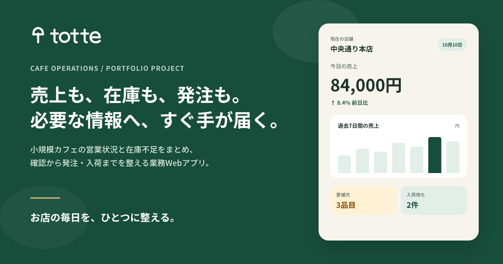
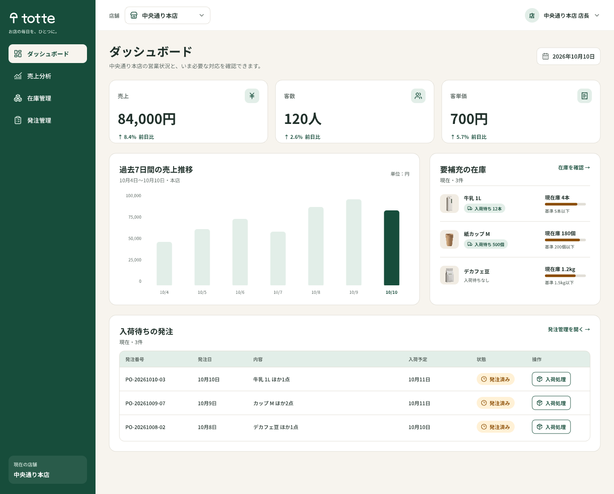
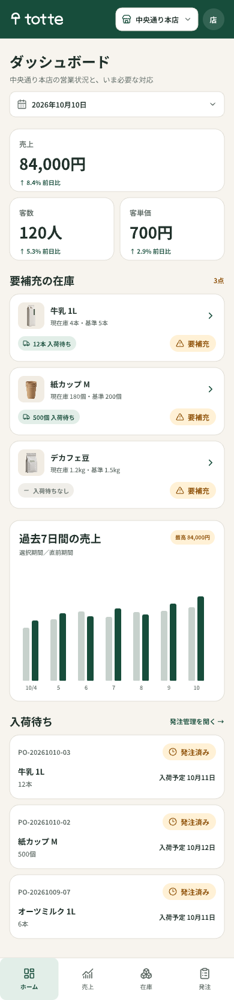

# totte（トッテ）



> お店の毎日を、ひとつに整える。

3店舗ほどを運営する小規模カフェの店長を想定した、売上・在庫・発注管理Webアプリの自主制作です。営業状況と在庫不足をまとめて確認し、発注から入荷、在庫反映までを一つの流れで操作できます。

**公開URL：** [https://coconattsu0723.github.io/totte/](https://coconattsu0723.github.io/totte/)

**制作状況：** 2026年10月11日 完了

## 主な画面

- ダッシュボード：売上・客数・客単価、要補充、入荷待ちを確認
- 売上分析：選択期間と同じ日数の直前期間を比較
- 在庫管理：現在庫、補充基準、入荷待ち、在庫状態を一覧表示
- 発注管理：発注作成、確認、入荷処理、入荷済み管理

<p>
  
  
</p>

## 中心となる操作

```text
在庫アラート
  → 在庫確認
  → 発注作成・確認・確定
  → 入荷処理
  → 在庫へ数量反映
```

- 発注フォームへ選択店舗と品目を引き継ぎます。
- 既存の入荷待ち数量を表示し、重複発注へ気づけるようにしています。
- 入荷済みの発注は再処理できない状態にし、在庫の二重加算を防ぎます。
- 店舗、在庫、発注状態はブラウザ内へ保存します。

## デザイン

薄いウォームグレーの背景、白いサーフェス、深いグリーンの主要操作を使い、業務画面としての可読性とカフェらしい温かさを両立しました。注意・エラー・完了は、色だけでなくアイコンと文言を併用しています。

品目サムネイルは、店舗で実物の資材を撮影して切り抜く運用を想定した背景透過素材です。このデモでは、第三者ブランドを使用しない架空の画像を採用しています。

## レスポンシブ対応

375 / 390 / 768 / 1024 / 1366 / 1440pxで確認しています。

- 1366 / 1440px：サイドバーと多列テーブル
- 1024px：簡潔なサイドバーと優先列へ絞ったテーブル
- 768px：ナビゲーションレールとカード一覧
- 375 / 390px：上部ヘッダー、下部ナビゲーション、1カラム表示

## 使用技術

- HTML
- CSS
- Vanilla JavaScript
- Pencil
- Git / GitHub Pages

外部フレームワークやサーバーは使用していません。

## プロジェクト構成

```text
totte/
├── index.html                 # 4画面をハッシュで切り替えるアプリ本体
├── 404.html                   # GitHub Pages用404ページ
├── assets/
│   ├── css/common.css         # トークン、共通UI、画面、レスポンシブ
│   ├── js/main.js             # データ、画面描画、発注・入荷、ブラウザ保存
│   └── images/
│       ├── brand/             # ロゴ、favicon、OGP
│       └── products/          # 14品目の背景透過画像
├── design/
│   ├── pencil/                # Pencil正本
│   └── exports/               # 確認用の書き出し画像
├── docs/                      # 企画、設計、実装、判断、引き継ぎ、ケーススタディ
├── AGENTS.md                  # プロジェクト固有の作業指示
└── README.md
```

4画面は1つの `index.html` 内で切り替えるため、下層HTML用の `pages/` は設けていません。アイコンは実装内のSVG、フォントはシステムフォントを使用しているため、未使用の `assets/icons/` と `assets/fonts/` も作成していません。

## ローカルで確認する

プロジェクトルートで静的サーバーを起動します。

```bash
python3 -m http.server 4173
```

ブラウザで `http://127.0.0.1:4173/` を開いてください。

## デモについて

- 架空サービスの自主制作です。
- 表示データ、店舗名、仕入先名はすべて架空です。
- 実際のPOS連携、認証、サーバー、仕入先への発注送信は行いません。
- 操作内容はブラウザのローカルストレージへ保存されます。
- 保存状態を初期化する場合は、このサイトのブラウザデータを削除してください。

## 制作資料

- [プロジェクト概要](docs/00_PROJECT_BRIEF.md)
- [画面・状態一覧](docs/01_SITE_STRUCTURE.md)
- [デザインルール](docs/02_DESIGN_RULES.md)
- [実装・QA記録](docs/04_IMPLEMENTATION_NOTES.md)
- [判断・変更記録](docs/05_DECISIONS_LOG.md)
- [ポートフォリオ・ケーススタディ](docs/07_PORTFOLIO_CASE_STUDY.md)

